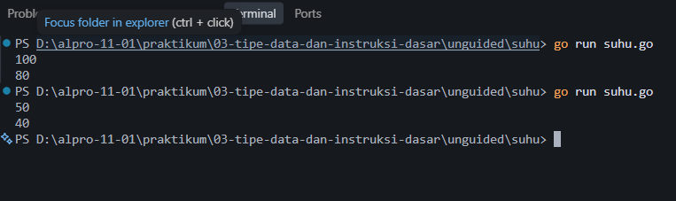
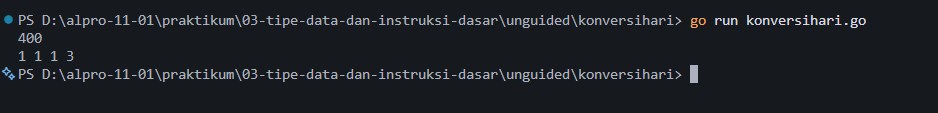

# <h1 align="center">Laporan Praktikum Unguided - Bahasa Pemrograman Go</h1>
<p align="center">Akmal Ghani Laoda - 109092600005</p>
## Unguided

### 1. `suhu.go`

``` go
package main

import "fmt"

func main() {
    var celsius float64
    fmt.Scan(&celsius)

    reamur := (4.0 / 5.0) * celsius

    fmt.Println(reamur)
}
```

##### Output



#### Deskripsi

Program `suhu.go` digunakan untuk mengonversi suhu dari derajat Celsius
menjadi derajat Reamur. Program menerima input suhu Celsius dalam bentuk
bilangan real menggunakan `fmt.Scan()`. Selanjutnya, suhu dikonversi
menggunakan rumus `R = (4/5) × C`. Hasil konversi kemudian ditampilkan
dalam bentuk bilangan real menggunakan `fmt.Println()`.

### 2. `konversihari.go`

``` go
package main

import "fmt"

func main() {
    var hari int
    fmt.Scan(&hari)

    tahun := hari / 360
    sisa := hari % 360

    bulan := sisa / 30
    sisa = sisa % 30

    minggu := sisa / 7
    sisa = sisa % 7

    fmt.Println(tahun, bulan, minggu, sisa)
}
```

##### Output



#### Deskripsi

Program `konversihari.go` digunakan untuk mengonversi jumlah hari
menjadi tahun, bulan, minggu, dan sisa hari. Program menerima input
berupa bilangan bulat menggunakan `fmt.Scan()`. Perhitungan dilakukan
berdasarkan ketentuan 1 tahun = 360 hari, 1 bulan = 30 hari, dan 1
minggu = 7 hari. Operator pembagian digunakan untuk mendapatkan jumlah
tahun, bulan, dan minggu, sedangkan operator modulus digunakan untuk
mendapatkan sisa hari. Hasil akhir ditampilkan secara berurutan
menggunakan `fmt.Println()`.

## Kesimpulan

Berdasarkan dua program unguided yang telah dibuat, dapat dipahami
penerapan dasar bahasa Go dalam menyelesaikan permasalahan konversi
menggunakan operasi aritmatika. Program `suhu.go` menerapkan operasi
perkalian dan pembagian untuk mengonversi suhu Celsius menjadi Reamur,
sedangkan program `konversihari.go` menerapkan operasi pembagian dan
modulus untuk mengubah jumlah hari menjadi tahun, bulan, minggu, dan
sisa hari. Dari praktikum ini dapat dipahami penggunaan variabel, input,
proses perhitungan, dan output dalam program Go secara lebih mandiri.

## Referensi

1.  Donovan, A. A. A., & Kernighan, B. W. (2015). *The Go Programming
    Language*. Boston: Addison-Wesley Professional. Diakses melalui
    https://www.gopl.io/
2.  The Go Authors. (2026). *The Go Programming Language Specification*.
    Diakses melalui https://go.dev/ref/spec
3.  The Go Authors. (2026). *A Tour of Go*. Diakses melalui
    https://go.dev/tour/
