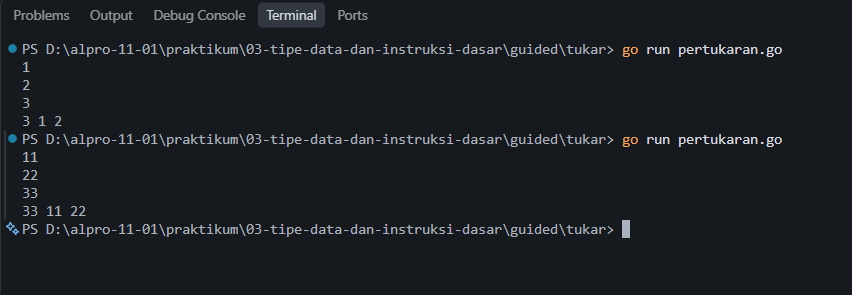
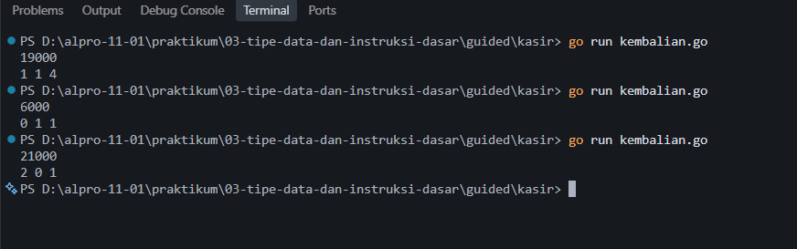

# <h1 align="center">Laporan Praktikum Guided - Bahasa Pemrograman Go</h1>
<p align="center">Akmal Ghani Laoda - 109092600005</p>

## Guided

### 1. `kelvinsuhu.go`

```go
package main

import "fmt"

func main() {
    var celsius float64
    fmt.Scan(&celsius)

    kelvin := celsius + 273

    fmt.Println(kelvin)
}
```

##### Output


#### Deskripsi

Program `kelvinsuhu.go` digunakan untuk mengonversi suhu dari derajat Celsius menjadi Kelvin. Program menerima masukan berupa bilangan real yang menyatakan suhu dalam derajat Celsius menggunakan `fmt.Scan()`. Selanjutnya, program menghitung suhu Kelvin dengan rumus `K = C + 273`. Hasil konversi ditampilkan menggunakan `fmt.Println()`. Sebagai contoh, jika masukan adalah `100`, keluaran yang dihasilkan adalah `373`.

### 2. `pertukaran.go`

```go
package main

import "fmt"

func main() {
    var x, y, z int
    fmt.Scan(&x, &y, &z)

    temp := x
    x = z
    z = y
    y = temp

    fmt.Println(x, y, z)
}
```

##### Output



#### Deskripsi

Program `pertukaran.go` digunakan untuk mempertukarkan nilai tiga bilangan bulat `x`, `y`, dan `z` sesuai ketentuan soal. Program membaca ketiga nilai menggunakan `fmt.Scan()`. Variabel sementara `temp` digunakan untuk menyimpan nilai awal `x` agar nilainya tidak hilang saat proses pertukaran. Setelah itu, nilai `x` diisi dengan nilai awal `z`, nilai `z` diisi dengan nilai awal `y`, dan nilai `y` diisi dengan nilai awal `x` yang tersimpan di `temp`. Hasil pertukaran ditampilkan secara berurutan menggunakan `fmt.Println()`. Contohnya, masukan `1 2 3` menghasilkan keluaran `3 1 2`.

### 3. `kembalian.go`

```go
package main

import "fmt"

func main() {
    var x int
    fmt.Scan(&x)

    sepuluhRibu := x / 10000
    x = x % 10000

    limaRibu := x / 5000
    x = x % 5000

    seribu := x / 1000

    fmt.Println(sepuluhRibu, limaRibu, seribu)
}
```

##### Output



#### Deskripsi

Program `kembalian.go` digunakan untuk menghitung jumlah lembar uang pecahan sepuluh ribu, lima ribu, dan seribu rupiah yang diperlukan untuk memberikan uang kembalian. Program menerima masukan berupa bilangan bulat `x` yang menyatakan jumlah uang kembalian. Pertama, program menghitung jumlah lembar sepuluh ribu menggunakan pembagian integer, lalu menggunakan operator modulus untuk memperoleh sisa uang. Proses yang sama dilakukan untuk pecahan lima ribu. Sisa uang kemudian dibagi seribu untuk memperoleh jumlah lembar seribuan. Hasil akhir ditampilkan berurutan, yaitu jumlah lembar sepuluh ribuan, lima ribuan, dan seribuan, dengan pemisah spasi. Sebagai contoh, masukan `19000` menghasilkan keluaran `1 1 4`.

## Kesimpulan

Berdasarkan tiga program guided yang telah dibuat, dapat dipahami penerapan dasar bahasa Go dalam menyelesaikan permasalahan konversi suhu, pertukaran nilai variabel, dan perhitungan uang kembalian. Program `kelvinsuhu.go` menggunakan operasi penjumlahan untuk mengonversi Celsius menjadi Kelvin. Program `pertukaran.go` menggunakan variabel sementara untuk menukar nilai tiga variabel sesuai urutan yang ditentukan. Sementara itu, program `kembalian.go` menerapkan operasi pembagian dan modulus untuk menentukan jumlah lembar uang dari setiap pecahan. Melalui praktikum ini, penggunaan variabel, input, operasi aritmatika, operator pembagian dan modulus, serta output dalam bahasa Go dapat dipahami dan diterapkan.

## Referensi

1. Donovan, A. A. A., & Kernighan, B. W. (2015). *The Go Programming Language*. Boston: Addison-Wesley Professional. Diakses melalui https://www.gopl.io/
2. The Go Authors. (2026). *The Go Programming Language Specification*. Diakses melalui https://go.dev/ref/spec
3. The Go Authors. (2026). *A Tour of Go*. Diakses melalui https://go.dev/tour/
