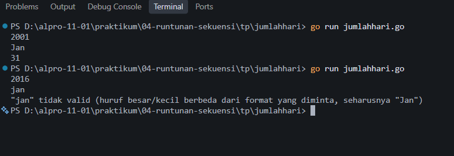
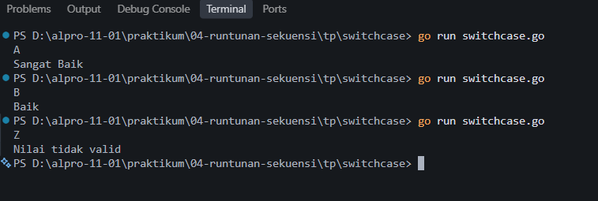

# <h1 align="center">Tugas Pendahuluan Modul 03 - Variabel dan Operator</h1>
<p align="center">Akmal Ghani Laoda - 109092600005</p>

## B. Soal Tugas Pendahuluan

### 1. Evaluasi Ekspresi Kontrol dalam Go

Diketahui nilai variabel berikut:

```go
intNum := 5
intOther := 10
var sngNum float64 = -3
```

Berikut hasil evaluasi setiap ekspresi kontrol berdasarkan nilai variabel tersebut.

| No. | True/False | Kondisi |
|---:|:---:|---|
| 1 | false | `intNum > 5` |
| 2 | true | `intNum >= 5 && intOther < 11` |
| 3 | true | `sngNum != -1 || intOther < 0` |
| 4 | true | `!(intNum > 3) || intNum <= 5` |
| 5 | false | `!(intOther >= intNum)` |
| 6 | true | `0 - sngNum > 0` |
| 7 | false | `4 / 2 == intOther / intNum` |
| 8 | true | `intOther % 2 == 0` |
| 9 | true | `intOther + 2 * intNum != 30 || !(sngNum > 0)` |
| 10 | true | `intOther > 0 && intNum > 0 || sngNum > 0` |
| 11 | true | `sngNum > 0 || (intNum >= 0 && -1 * intOther == -10)` |
| 12 | true | `intNum == 5` |
| 13 | true | `intNum > 0 || (sngNum <= 0 && intOther == 13)` |
| 14 | true | `!(!(!(!(intNum > 0))))` |

#### Deskripsi

Ekspresi kontrol dievaluasi berdasarkan nilai `intNum = 5`, `intOther = 10`, dan `sngNum = -3`. Operator perbandingan menghasilkan nilai boolean, sedangkan operator logika `&&`, `||`, dan `!` digunakan untuk menggabungkan atau membalik nilai kondisi. Pada Go, operator `&&` bernilai true jika kedua kondisi true, sedangkan `||` bernilai true jika setidaknya satu kondisi true. Operator `!` membalik nilai boolean.

### 2. Tracing: Evaluasi Pernyataan Kondisi

Kode program pada soal menggunakan variabel awal `x = 10`, `y = 5`, `z = 15`, dan `result = 0`.

#### Langkah-langkah alur eksekusi

1. **Kondisi 1: `x > 5`**

   Kondisi `10 > 5` bernilai `true`, sehingga program memeriksa kondisi di dalamnya, yaitu `y < 10`. Kondisi `5 < 10` juga bernilai `true`, maka `result = x + y = 10 + 5 = 15`.

2. **Kondisi 2: `z > 10 && x == 10`**

   Kondisi `15 > 10` bernilai `true` dan `10 == 10` juga bernilai `true`. Karena kedua kondisi benar, program menjalankan `result += z`, sehingga `result = 15 + 15 = 30`.

3. **Kondisi 3: `x == 10 || y > 10`**

   Kondisi `x == 10` bernilai `true`. Karena operator yang digunakan adalah `||`, cukup satu kondisi bernilai true agar seluruh ekspresi true. Program menjalankan `result += 5`, sehingga `result = 30 + 5 = 35`. Cabang `else if` dan `else` tidak dijalankan.

4. **Kondisi 4: `!(x < 15 && y < 10)`**

   Kondisi `x < 15` adalah `true`, dan `y < 10` juga `true`. Gabungan keduanya dengan `&&` menghasilkan `true`, kemudian operator `!` membaliknya menjadi `false`. Karena kondisi `if` bernilai false, program menjalankan `result -= 10`, sehingga `result = 35 - 10 = 25`.

#### Jawaban

1. Nilai akhir variabel `result` adalah **25**.
2. Output program:

   ```text
   Nilai akhir result: 25
   ```
3. Nilai akhir variabel lainnya tetap `x = 10`, `y = 5`, dan `z = 15`, karena tidak ada pernyataan yang mengubah nilai ketiga variabel tersebut.

### 3. Menentukan Jumlah Hari dalam Sebulan Berdasarkan Tahun dan Bulan

```go
package main

import (
	"fmt"
)

// Fungsi untuk mengecek apakah suatu tahun adalah tahun kabisat
func isKabisat(tahun int) bool {
	return (tahun%4 == 0 && tahun%100 != 0) || (tahun%400 == 0)
}

func main() {
	var tahun int
	var bulan string

	// Menerima input tahun dan bulan
	fmt.Scan(&tahun, &bulan)

	// Penentuan jumlah hari berdasarkan input bulan
	switch bulan {
	case "Jan", "Mar", "Mei", "Jul", "Agu", "Okt", "Des":
		fmt.Println(31)
	case "Apr", "Jun", "Sep", "Nov":
		fmt.Println(30)
	case "Feb":
		if isKabisat(tahun) {
			fmt.Println(29)
		} else {
			fmt.Println(28)
		}
	default:
		// Jika input bulan tidak sesuai format/nama yang ditentukan
		fmt.Println("\"" + bulan + "\" tidak valid (huruf besar/kecil berbeda dari format yang diminta, seharusnya \"Jan\")")
	}
}
```

##### Output



#### Deskripsi

Program ini digunakan untuk menentukan jumlah hari dalam suatu bulan berdasarkan input tahun dan tiga huruf pertama nama bulan. Program membaca tahun dalam tipe data `int` dan nama bulan dalam tipe data `string`. Pernyataan `switch` digunakan untuk menentukan jumlah hari berdasarkan nama bulan yang dimasukkan. Bulan Januari, Maret, Mei, Juli, Agustus, Oktober, dan Desember memiliki 31 hari, sedangkan April, Juni, September, dan November memiliki 30 hari.

Untuk bulan Februari, program memeriksa apakah tahun tersebut merupakan tahun kabisat. Tahun termasuk kabisat jika habis dibagi 400, atau habis dibagi 4 tetapi tidak habis dibagi 100. Jika tahun kabisat, Februari memiliki 29 hari; jika bukan, Februari memiliki 28 hari. Nama bulan harus sesuai format yang ditentukan, misalnya `Jan`, bukan `jan`. Jika nama bulan tidak valid, program menampilkan pesan kesalahan dan berhenti.

Contoh input `2001 Jan` menghasilkan output `31`, sedangkan input `2016 Feb` menghasilkan output `29`.

### 4. Contoh Program Switch Case

```go
package main

import "fmt"

func main() {
    var nilai string
    fmt.Scan(&nilai)

    switch nilai {
    case "A":
        fmt.Println("Sangat Baik")
    case "B":
        fmt.Println("Baik")
    case "C":
        fmt.Println("Cukup")
    case "D":
        fmt.Println("Kurang")
    default:
        fmt.Println("Nilai tidak valid")
    }
}
```

##### Output



#### Deskripsi

Program ini merupakan contoh penggunaan `switch case` dalam bahasa Go untuk menentukan keterangan berdasarkan nilai huruf yang dimasukkan. Program membaca input berupa string, kemudian memeriksa nilainya melalui beberapa `case`. Jika input adalah `A`, program menampilkan `Sangat Baik`; jika `B`, menampilkan `Baik`; jika `C`, menampilkan `Cukup`; dan jika `D`, menampilkan `Kurang`. Apabila input tidak sesuai dengan pilihan yang tersedia, bagian `default` menampilkan pesan `Nilai tidak valid`.

## Kesimpulan

Melalui tugas pendahuluan ini, dapat dipahami penggunaan ekspresi boolean, operator perbandingan, operator logika, serta pernyataan kondisi `if`, `else if`, dan `else` dalam bahasa Go. Proses tracing membantu memahami perubahan nilai variabel sesuai urutan eksekusi program. Selain itu, pernyataan `switch case` dapat digunakan untuk memilih tindakan berdasarkan nilai tertentu, seperti menentukan jumlah hari dalam bulan dan menampilkan keterangan nilai. Penggunaan kondisi tahun kabisat juga menunjukkan bagaimana beberapa ekspresi logika dapat digabungkan untuk menyelesaikan permasalahan.
