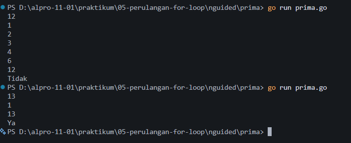

# <h1 align="center">Laporan Praktikum Mandiri - Bahasa Pemrograman Go</h1>
<p align="center">Akmal Ghani Laoda - 109092600005</p>

## Mandiri

### 1. `prima.go`

```go
package main

import "fmt"

func main() {
    var n int
    fmt.Scan(&n)

    jumlahFaktor := 0

    for i := 1; i <= n; i++ {
        if n%i == 0 {
            fmt.Println(i)
            jumlahFaktor++
        }
    }

    if jumlahFaktor == 2 {
        fmt.Println("Ya")
    } else {
        fmt.Println("Tidak")
    }
}
```

##### Output



#### Deskripsi

Program `prima.go` digunakan untuk menampilkan seluruh faktor dari sebuah bilangan bulat positif dan menentukan apakah bilangan tersebut merupakan bilangan prima. Program membaca bilangan `n` menggunakan `fmt.Scan()`, kemudian melakukan perulangan dari 1 hingga `n`. Pada setiap perulangan, program memeriksa apakah `n` habis dibagi oleh nilai `i` menggunakan operator modulus (`%`). Jika sisa pembagian sama dengan nol, nilai `i` merupakan faktor dari `n` dan ditampilkan menggunakan `fmt.Println()`. Program juga menghitung jumlah faktor yang ditemukan. Setelah perulangan selesai, jika jumlah faktor tepat dua, program menampilkan `Ya`, yang berarti bilangan tersebut merupakan bilangan prima. Jika jumlah faktornya bukan dua, program menampilkan `Tidak`. Contohnya, masukan `12` menampilkan faktor 1, 2, 3, 4, 6, dan 12, kemudian menghasilkan keluaran `Tidak` karena 12 memiliki enam faktor.

### 2. `ecct.go`

```go
package main

import "fmt"

func main() {
    var m int
    fmt.Scan(&m)

    jumlahSertifikat := 0

    for i := 1; i <= m; i++ {
        var p, v, ga, fs, ci, tc int
        fmt.Scan(&p, &v, &ga, &fs, &ci, &tc)

        total := p + v + ga + fs + ci + tc

        if float64(total)/6 >= 3.33 {
            fmt.Println("Ya")
            jumlahSertifikat++
        } else {
            fmt.Println("Tidak")
        }
    }

    fmt.Println(jumlahSertifikat)
}
```

##### Output


#### Deskripsi

Program `ecct.go` digunakan untuk menentukan apakah setiap mahasiswa baru Telkom University dalam satu kelompok mendapatkan sertifikat ECCT berdasarkan rata-rata enam nilai tes, yaitu P, V, GA, FS, CI, dan TC. Program membaca jumlah mahasiswa `m`, kemudian menggunakan perulangan untuk membaca enam nilai dari setiap mahasiswa. Seluruh nilai dijumlahkan dan disimpan dalam variabel `total`. Rata-rata dihitung dengan membagi total nilai dengan 6. Jika rata-rata minimal 3,33, program menampilkan `Ya` dan menambahkan satu ke variabel `jumlahSertifikat`. Jika rata-rata kurang dari 3,33, program menampilkan `Tidak`. Setelah seluruh mahasiswa diproses, program menampilkan jumlah mahasiswa yang mendapatkan sertifikat. Contohnya, jika masukan berisi tiga mahasiswa dengan total nilai masing-masing 19, 23, dan 20, keluaran statusnya adalah `Tidak`, `Ya`, dan `Ya`, dengan jumlah penerima sertifikat sebanyak 2 mahasiswa.

## Kesimpulan

Berdasarkan dua program mandiri yang telah dibuat, dapat dipahami penerapan perulangan, percabangan, operator aritmatika, serta input dan output dalam bahasa Go. Program `prima.go` menggunakan perulangan dan operator modulus untuk menemukan seluruh faktor suatu bilangan, kemudian menentukan bilangan prima berdasarkan jumlah faktornya. Sementara itu, program `ecct.go` menggunakan perulangan untuk memproses nilai setiap mahasiswa, menghitung rata-rata enam nilai tes, menentukan kelayakan sertifikat ECCT, dan menghitung jumlah mahasiswa yang memenuhi syarat. Melalui praktikum ini, penggunaan variabel, perulangan, percabangan, operator, serta fungsi input dan output dalam bahasa Go dapat dipahami dan diterapkan.

## Referensi

1. Donovan, A. A. A., & Kernighan, B. W. (2015). *The Go Programming Language*. Boston: Addison-Wesley Professional. Diakses melalui https://www.gopl.io/
2. The Go Authors. (2026). *The Go Programming Language Specification*. Diakses melalui https://go.dev/ref/spec
3. The Go Authors. (2026). *A Tour of Go*. Diakses melalui https://go.dev/tour/
